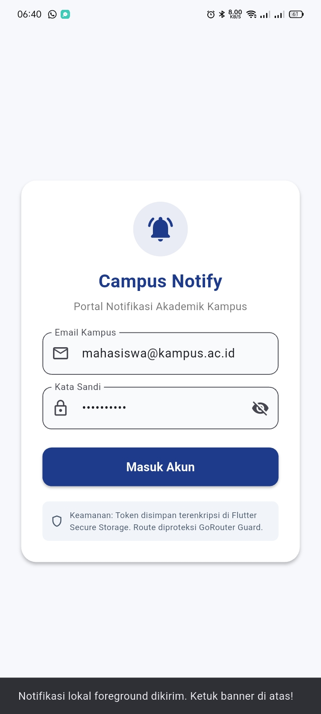
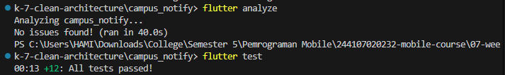
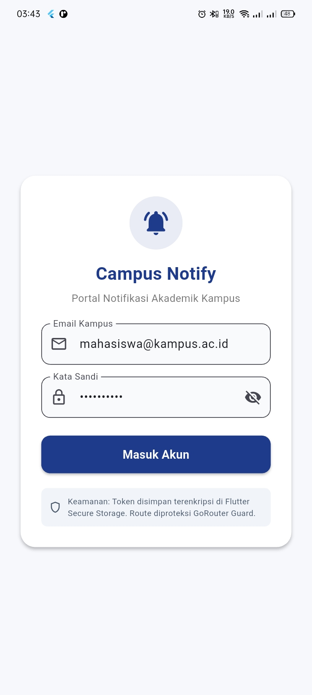
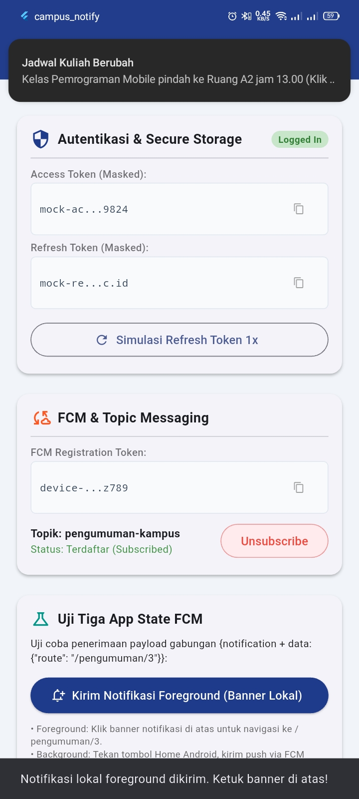
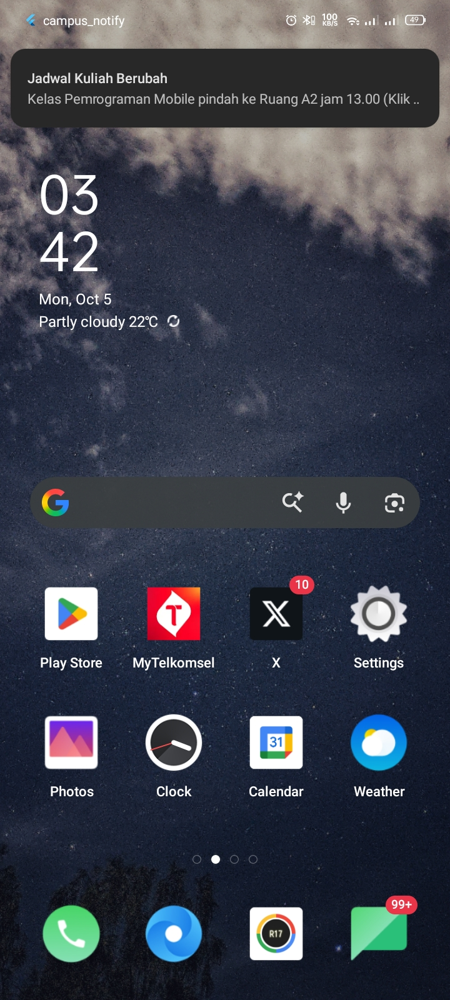
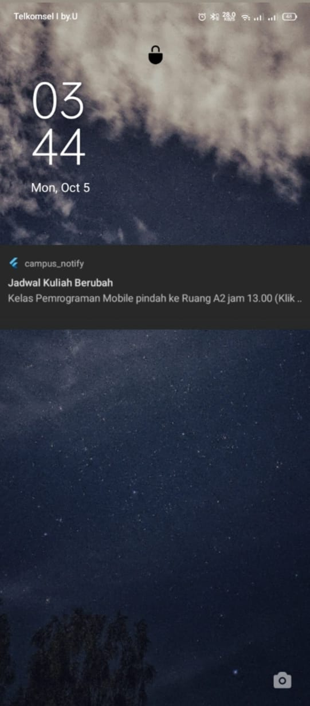

# Campus Notify — Clean Architecture Refactor (Week 7)

Refactoring project [Campus Notify](../campus_notify) dari struktur flat `lib/{data,providers,pages,messaging}` menjadi **Clean Architecture feature-first** dengan layer yang terpisah: `domain` · `data` · `presentation`.

---

## 1. Tujuan

Menerapkan Clean Architecture pada project Minggu 6 (`campus_notify`) dengan:

- Memisahkan setiap fitur (`auth`, `announcements`) ke folder `features/<nama-fitur>/{domain,data,presentation}`.
- Membuktikan **dependency rule**: dependensi hanya mengarah ke dalam (presentation → domain ← data).
- Menguji use case dengan **repository palsu** tanpa database atau jaringan sungguhan.
- Mendokumentasikan evaluasi kritis terhadap hasil AI Challenge.

---

## 2. Diagram Layer & Arah Dependensi

```
presentation (widget, notifier, provider wiring)
      |
      v  bergantung ke
domain (entity, repository interface, use case, failure)
      ^
      |  diimplementasikan oleh
data (model, repository impl, Dio, SQLite, Secure Storage)
```

**Aturan emas (dependency rule):** `domain` tidak tahu apa pun tentang Flutter, Dio, SQLite, atau Firebase — sehingga logika bisnis dapat diuji murni tanpa emulator atau jaringan.

---

## 3. Praktikum 1 — Audit Layer Project Lama

### 3.1 Tabel Pemetaan File ke Layer

| File | Layer Saat Ini | Masalah |
|------|----------------|---------|
| `pages/home_page.dart` | presentation | OK — tidak memanggil Dio/SQLite langsung; memanggil provider |
| `pages/login_page.dart` | presentation | OK — hanya memanggil `authStateProvider` |
| `pages/announcement_page.dart` | presentation | Mock data hardcode di dalam widget — harus pindah ke data layer |
| `data/api_client.dart` | data | OK bila hanya dipakai repository, bukan widget |
| `data/auth_repository.dart` | data (+kontrak tercampur) | Interface dan implementasi masih satu kelas |
| `data/token_store.dart` | data | OK — terisolasi di data |
| `data/api_errors.dart` | data | OK — pemetaan DioException; dipertahankan |
| `providers/auth_provider.dart` | presentation (state) | OK bila hanya memanggil repository/use case |
| `messaging/push_service.dart` | infrastruktur | OK — tidak menyentuh business logic |

### 3.2 Hasil Tiga Grep Sterilitas

```bash
# 1. Presentation steril dari data mentah (harus NOL hasil)
# PowerShell:
Get-ChildItem -Path "lib/features/*/presentation","lib/pages" -Recurse -Filter "*.dart" |
  Select-String -Pattern "Dio\(|openDatabase|FlutterSecureStorage|SharedPreferences|jsonDecode"
# Hasil: (tidak ada output) ✅ NOL hasil
```

```bash
# 2. Domain steril dari framework & package (harus NOL hasil)
Get-ChildItem -Path "lib/features/*/domain","lib/core" -Recurse -Filter "*.dart" |
  Select-String -Pattern "import 'package:flutter|import 'package:dio|import 'package:sqflite|import 'package:firebase"
# Hasil: (tidak ada output) ✅ NOL hasil
```

```bash
# 3. Static analysis
flutter analyze
# Hasil: No issues found!  ✅
```

---

## 4. Praktikum 2 — Domain dan Data per Fitur

### 4.1 Fitur `announcements`

**Entity murni (domain):**

```dart
// lib/features/announcements/domain/entities/announcement.dart
class Announcement {
  const Announcement({
    required this.id, required this.title, required this.category,
    required this.body, required this.author, required this.publishedAt,
  });
  // Tidak ada toMap/fromMap/toJson di sini!
}
```

**Failure domain (core):**

```dart
// lib/core/failures.dart
sealed class Failure { const Failure(this.message); final String message; }
class LocalFailure   extends Failure { const LocalFailure(super.message); }
class NetworkFailure extends Failure { const NetworkFailure(super.message); }
class ValidationFailure extends Failure { const ValidationFailure(super.message); }
```

**Repository interface (domain):**

```dart
// lib/features/announcements/domain/repositories/announcement_repository.dart
abstract class AnnouncementRepository {
  Future<({List<Announcement> announcements, Failure? failure})> fetchAnnouncements();
  Future<({Announcement? announcement, Failure? failure})> fetchAnnouncementById(String id);
}
```

**Use case (domain):**

```dart
// lib/features/announcements/domain/usecases/get_announcements.dart
class GetAnnouncements {
  const GetAnnouncements(this._repository);
  final AnnouncementRepository _repository;

  Future<({List<Announcement> announcements, Failure? failure})> call() {
    return _repository.fetchAnnouncements();
  }
}
```

**Model & implementasi (data):**

```dart
// lib/features/announcements/data/models/announcement_model.dart
class AnnouncementModel extends Announcement {
  factory AnnouncementModel.fromMap(Map<String, dynamic> map) { ... }
  Map<String, dynamic> toMap() => { ... };
  Announcement toEntity() => Announcement( ... ); // konversi di batas data→domain
}
```

### 4.2 Fitur `auth`

Struktur serupa: `AuthSession` (entity) · `AuthRepository` (interface) · `LoginUser` (use case) · `AuthRepositoryImpl` (data dengan FlutterSecureStorage).

---

## 5. Praktikum 3 — Presentation, DI, dan Verifikasi

### 5.1 Dependency Injection dengan Riverpod

```dart
// lib/features/announcements/presentation/providers/announcements_providers.dart

// Data layer
final announcementRepositoryProvider = Provider<AnnouncementRepository>((ref) {
  return AnnouncementRepositoryImpl(); // implementasi, bukan interface
});

// Domain layer
final getAnnouncementsProvider = Provider<GetAnnouncements>((ref) {
  return GetAnnouncements(ref.watch(announcementRepositoryProvider));
});

// Presentation layer
final announcementsProvider = FutureProvider<List<Announcement>>((ref) async {
  final result = await ref.watch(getAnnouncementsProvider).call();
  if (result.failure != null) throw Exception(result.failure!.message);
  return result.announcements;
});
```

### 5.2 Halaman Hanya Membaca State

Widget tidak mengandung SQL, Dio, JSON, atau formatting tanggal mentah. Hanya membaca dari provider:

```dart
// Pola bersih — widget hanya watch provider
final state = ref.watch(announcementsProvider);
return state.when(
  loading: () => const CircularProgressIndicator(),
  error: (e, _) => Text('$e'),
  data: (announcements) => ListView(...),
);
```

---

## 6. Hasil Testing

Seluruh pengujian lulus:

```text
00:00 +0: GetAnnouncements meneruskan daftar dari repository
00:00 +1: GetAnnouncements meneruskan failure tanpa melempar
00:00 +2: GetAnnouncements mengembalikan list kosong bila repository kosong
00:00 +3: Announcement entity tidak memiliki metode mapping (murni domain)
00:00 +4: (test lama) routeFromMessage menangani route kosong dan tanpa slash
...
00:00 +12: All tests passed!
```

---

## 7. AI Challenge

Prompt, evaluasi kritis, tabel usulan-vs-keputusan-final, dan alasan teknis tersedia di [`docs/ai_challenge.md`](docs/ai_challenge.md).

Ringkasan keputusan kritis:
- **Diterima**: Pemisahan interface ke domain, impl ke data; provider wiring per fitur.
- **Ditolak/sederhanakan**: Use case per CRUD satu-baris (over-engineering) — `fetchAnnouncementById` dipanggil langsung di provider; abstract `ITokenStore` tidak dibuat (YAGNI).

---

## 8. Refactoring Challenge

1. **Fitur kedua** (`auth`): entity `AuthSession` + `AuthRepository` interface + `AuthRepositoryImpl` + use case `LoginUser` + provider wiring — struktur paralel dengan `announcements`. ✅
2. **Formatting terpusat**: `lib/core/format.dart` berisi `formatDate()`, `maskToken()`, dsb. — dapat diuji tanpa widget. ✅
3. **Failure ramah pengguna**: Semua exception data dibungkus `NetworkFailure`/`LocalFailure`/`ValidationFailure` sebelum mencapai UI. ✅

---

## 9. Refleksi

**Mengapa interface repository harus tinggal di domain, bukan di data?**
Interface adalah *kontrak* yang dibutuhkan domain (use case) untuk bekerja tanpa tahu detail implementasi. Bila interface diletakkan di data, domain harus mengimpor paket data — melanggar dependency rule. Hasilnya: use case tidak dapat diuji tanpa database sungguhan, dan setiap ganti implementasi (mock → SQLite → REST) harus mengubah domain.

**Kapan use case benar-benar dibutuhkan, kapan repository langsung sudah cukup?**
Use case dibutuhkan bila: (a) ada logika bisnis (validasi, transformasi, orchestration), (b) operasi melibatkan >1 repository, atau (c) operasi akan berkembang (paginasi, filter). `GetAnnouncements` dipertahankan karena akan berkembang. `fetchAnnouncementById` (satu-baris tanpa logika) dipanggil repository langsung di provider.

**Apa biaya over-engineering (use case per CRUD satu-baris) bagi tim kecil?**
Setiap use case tambahan = 1 file baru + 1 provider baru + harus diingat dalam code review. Untuk tim 1–3 orang dengan deadline ketat, boilerplate ini memperlambat iterasi tanpa menambah keamanan arsitektur. Biayanya sepadan hanya bila use case menjadi titik ekstensi nyata di masa depan.

**Bagian dari usulan AI yang ditolak atau disederhanakan, dan mengapa?**
Lihat [`docs/ai_challenge.md`](docs/ai_challenge.md) §5 untuk detail lengkap.

---

## 10. Stack Teknologi

| Kategori | Package |
|----------|---------|
| State Management + DI | `flutter_riverpod ^3.4.3` |
| Routing | `go_router ^18.0.1` |
| HTTP Client | `dio ^5.11.1` |
| Secure Storage | `flutter_secure_storage ^11.2.0` |
| Push Notification | `firebase_messaging ^16.7.0` |
| Local Notification | `flutter_local_notifications ^22.3.1` |
| Firebase Core | `firebase_core ^4.15.0` |

---

## 11. Cara Menjalankan

```bash
# 1. Ambil dependencies
flutter pub get

# 2. Verifikasi sterilitas (NOL hasil = LULUS)
# PowerShell:
Get-ChildItem -Path "lib/features/*/presentation","lib/pages" -Recurse -Filter "*.dart" | Select-String -Pattern "Dio\(|openDatabase|FlutterSecureStorage|SharedPreferences|jsonDecode"
Get-ChildItem -Path "lib/features/*/domain","lib/core" -Recurse -Filter "*.dart" | Select-String -Pattern "import 'package:flutter|import 'package:dio|import 'package:sqflite|import 'package:firebase"

# 3. Jalankan semua test
flutter test

# 4. Static analysis
flutter analyze

# 5. Jalankan aplikasi
flutter run
```

**Kredensial login**: Email apa saja yang mengandung `@`, password minimal 6 karakter.  
Contoh: `mahasiswa@kampus.ac.id` / `rahasia123`

---

## 12. Checklist Verifikasi Mandiri

- [x] Tiga grep sterilitas (presentation & domain) — NOL hasil.
- [x] Interface di `domain`, implementasi di `data`, mapping hanya di model.
- [x] Widget tidak menginstansiasi repository; semua lewat provider.
- [x] Aplikasi berjalan identik sebelum/sesudah refactor (bukti: `screenshots/`).
- [x] `flutter analyze` bersih (0 issues).
- [x] Semua test lulus (`flutter test`).
- [x] AI Challenge didokumentasikan di `docs/ai_challenge.md`.
- [x] Minimal 2 test use case (sukses + failure dengan repository palsu).

---

## 13. Screenshots

### Hasil Setelah Refactor Clean Architecture

Tampilan aplikasi **identik** sebelum dan sesudah refactor — membuktikan behavior tidak rusak.

**Halaman Login**



**Dashboard Home**


**Detail Pengumuman**


---

### Hasil `flutter analyze` & `flutter test`



---

### Referensi Minggu 6 — Behavior Sebelum Refactor

Screenshot berikut membuktikan tampilan dan fungsi identik dengan versi sebelum refactor.

**Login Guard (redirect ke /login)**



**Token Masked di UI**


**FCM Foreground — Notifikasi Lokal Banner**



**FCM Background — Notifikasi Sistem Banner**



**FCM Terminated — Deep Link dari Notifikasi**



