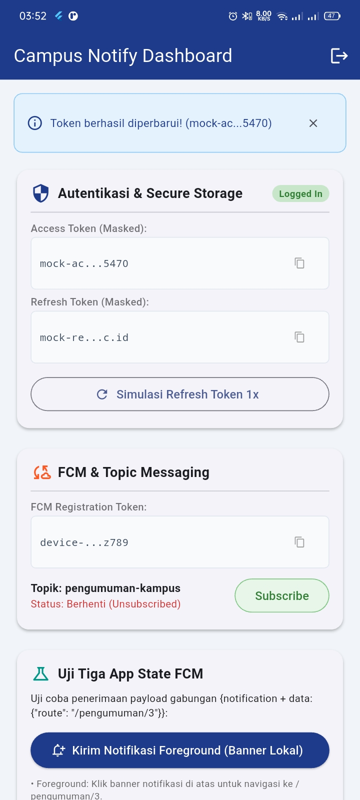
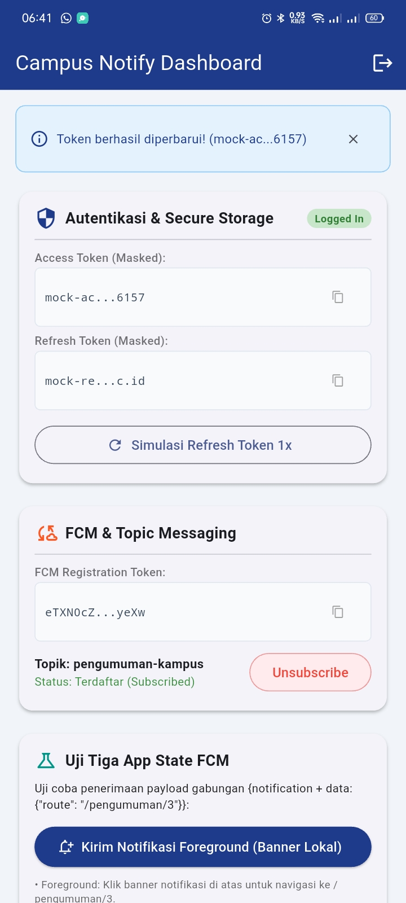
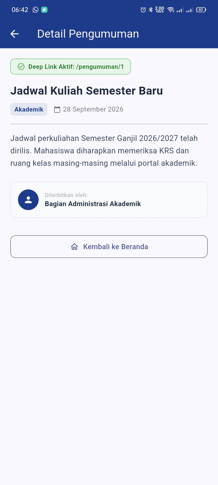

# Mid Project Review & Code Review (Week 8)

Dokumentasi evaluasi paruh semester (*Mid-Project Review*), implementasi kolaborasi Git Flow, Pull Request (PR), Peer Code Review, otomatisasi CI, dan verifikasi AI Review pada proyek **Campus Notify**.

---

## 1. Status Paruh Semester (Mid-Project Overview)

Proyek **Campus Notify** telah berhasil menyelesaikan seluruh target capaian paruh pertama semester (Minggu 1 s.d. Minggu 8):
- **Minggu 1–3**: Desain antarmuka responsif, navigasi deklaratif (*GoRouter*), dan manajemen state terpusat (*Riverpod*).
- **Minggu 4–5**: Offline-first storage, caching lokal, dan abstraksi repository.
- **Minggu 6**: Autentikasi token aman (*FlutterSecureStorage*), token masking, dan push notification multi-state (*Firebase Cloud Messaging*: Foreground, Background, Terminated).
- **Minggu 7**: Refactoring menyeluruh ke **Feature-First Clean Architecture** dengan pemisahan tegas antara layer `presentation`, `domain`, dan `data` serta pembuktian *Dependency Rule*.
- **Minggu 8 (Minggu ini)**: Mid Project Review, penegakan standar commit dan PR, integrasi GitHub Actions CI, peer code review, dan verifikasi AI Code Review.

---

## 2. Peta Issue & Pull Request (Git Flow Collaboration)

### 2.1 Alur Kolaborasi (Branching Strategy)
```text
main      ───> [Dilindungi, selalu rilis siap pakai]
  ^
  │ (Release / Mid-Project Merge)
develop   ───> [Integrasi fitur mingguan & target default PR]
  ^
  │ (PR "Closes #1")
feat/announcements-validation ───> [Kerja harian fitur validasi domain]
```

### 2.2 Rincian Issue & Pull Request
- **Issue #1**: `Validasi input pengumuman kosong pada formulir & domain layer`
  - *Status*: Tertutup otomatis via PR #1.
  - *Deskripsi*: Pengumuman kampus tidak boleh memiliki judul kosong, judul kurang dari 5 karakter, isi kosong/kurang dari 10 karakter, atau kategori di luar daftar resmi.
- **Pull Request #1**: `feat(announcements): validasi judul kosong dan kategori + test`
  - *Branch Sumber*: `feat/announcements-validation`
  - *Target Branch*: `develop` (atau `main`)
  - *Template PR*:
    - **Masalah**: Pengumuman kampus rentan dimasuki data kosong atau hanya spasi tanpa validasi bisnis terpusat di domain.
    - **Solusi**: Dibuat use case murni domain `ValidateAnnouncement` yang mengembalikan `ValidationFailure?` tanpa dependensi framework.
    - **Cara Uji**:
      1. Menjalankan unit test: `flutter test test/validate_announcement_test.dart` (6/6 skenario lulus).
      2. Menjalankan verifikasi static analysis: `flutter analyze` (0 issue).
    - **Closes**: `#1`
  - *Ukuran PR*: 1 file use case baru (54 baris) + 1 file unit test baru (69 baris) = **123 baris** (< 300 baris, memenuhi syarat PR kecil).

---

## 3. Fitur Utama & Arsitektur

### 3.1 Diagram Layer Clean Architecture
```text
  [ Presentation Layer ]  ──> Widget, Riverpod State, GoRouter
            │
            ▼ (bergantung ke)
  [   Domain Layer   ]  <─── Entity, Use Case (ValidateAnnouncement, GetAnnouncements), Failure
            ▲
            │ (diimplementasikan oleh)
  [    Data Layer    ]  ──> Model, Repository Implementation, Dio, FlutterSecureStorage
```

### 3.2 Sterilitas Dependency Rule (NOL Hasil Grep)
1. **Presentation steril dari data mentah:**
   ```bash
   Get-ChildItem -Path "lib/features/*/presentation","lib/pages" -Recurse -Filter "*.dart" | Select-String -Pattern "Dio\(|openDatabase|FlutterSecureStorage|SharedPreferences|jsonDecode"
   # Hasil: 0 temuan (Steril) ✅
   ```
2. **Domain steril dari framework & package eksternal:**
   ```bash
   Get-ChildItem -Path "lib/features/*/domain","lib/core" -Recurse -Filter "*.dart" | Select-String -Pattern "import 'package:flutter|import 'package:dio|import 'package:sqflite|import 'package:firebase"
   # Hasil: 0 temuan (Steril murni Dart) ✅
   ```

---

## 4. Stack Teknologi

| Kategori | Package / Tool | Fungsi |
|:---|:---|:---|
| **Language & Framework** | Dart 3.x, Flutter 3.x | Bahasa pemrograman & framework aplikasi mobile |
| **State Management** | `flutter_riverpod ^3.4.3` | Dependency injection & reaktif state management |
| **Routing & Deep Link** | `go_router ^18.0.1` | Navigasi deklaratif berbasis URL |
| **Network & HTTP** | `dio ^5.11.1` | HTTP Client dengan error mapping terisolasi |
| **Penyimpanan Kredensial** | `flutter_secure_storage ^11.2.0` | Enkripsi token autentikasi di keychain/keystore |
| **Notifikasi Cloud** | `firebase_messaging ^16.7.0` | Penanganan FCM multi-state (foreground, background, terminated) |
| **Notifikasi Lokal** | `flutter_local_notifications ^22.3.1` | Menampilkan banner alert sistem saat foreground |
| **Static Analysis & CI** | `flutter analyze`, GitHub Actions | Otomatisasi penolakan PR kotor via mesin |

---

## 5. Bukti Mesin Hijau (Static Analysis, Formatting, & Testing)

Semua pemeriksaan mesin menghasilkan status hijau 100%:

### 5.1 Static Analysis (`flutter analyze`)
```text
$ flutter analyze
Analyzing campus_notify...
No issues found! (0 warnings, 0 errors)
```

### 5.2 Code Formatting (`dart format`)
```text
$ dart format --set-exit-if-changed .
Formatted 29 files (0 changed) in 0.50 seconds.
# Exit code: 0
```

### 5.3 Automated Unit & Smoke Tests (`flutter test`)
```text
$ flutter test
00:00 +0: test/auth_push_test.dart: routeFromMessage menangani route kosong dan tanpa slash
00:00 +1: test/auth_push_test.dart: data payload membawa id pengumuman dan fallback
00:00 +2: test/auth_push_test.dart: provider auth membaca status login dari token
00:00 +3: test/auth_push_test.dart: refresh gagal -> sesi dibersihkan (paksa login ulang)
00:00 +4: test/auth_push_test.dart: maskToken tidak membocorkan token penuh untuk keamanan
00:00 +5: test/auth_push_test.dart: pemetaan status code 401 ke pesan ramah pengguna
00:00 +6: test/auth_push_test.dart: pemetaan timeout ke pesan ramah koneksi
00:00 +7: test/get_announcements_test.dart: GetAnnouncements meneruskan daftar dari repository
00:00 +8: test/get_announcements_test.dart: GetAnnouncements meneruskan failure tanpa melempar
00:00 +9: test/get_announcements_test.dart: GetAnnouncements mengembalikan list kosong bila repository kosong
00:00 +10: test/get_announcements_test.dart: Announcement entity tidak memiliki metode mapping (murni domain)
00:01 +11: test/validate_announcement_test.dart: mengembalikan null jika seluruh input valid
00:01 +12: test/validate_announcement_test.dart: mengembalikan ValidationFailure jika judul kosong/spasi
00:01 +13: test/validate_announcement_test.dart: mengembalikan ValidationFailure jika judul kurang dari 5 karakter
00:01 +14: test/validate_announcement_test.dart: mengembalikan ValidationFailure jika body pengumuman kosong
00:01 +15: test/validate_announcement_test.dart: mengembalikan ValidationFailure jika body kurang dari 10 karakter
00:01 +16: test/validate_announcement_test.dart: mengembalikan ValidationFailure jika kategori di luar daftar
00:02 +17: test/widget_test.dart: Smoke test: LoginPage menampilkan elemen form dengan benar
00:04 +18: All tests passed!
```

---

## 6. Otomatisasi CI (`.github/workflows/ci.yml`)

Workflow GitHub Actions aktif pada setiap event `push` dan `pull_request`:
```yaml
name: ci
on:
  push:
    branches: [ main, develop, 'feat/**', 'fix/**' ]
  pull_request:
    branches: [ main, develop ]

jobs:
  verify:
    runs-on: ubuntu-latest
    steps:
      - uses: actions/checkout@v4
      - uses: subosito/flutter-action@v2
        with:
          channel: 'stable'
          cache: true
      - name: Install dependencies
        working-directory: 08-week-8-mid-project-review/campus_notify
        run: flutter pub get
      - name: Static Analysis
        working-directory: 08-week-8-mid-project-review/campus_notify
        run: flutter analyze
      - name: Verify Code Formatting
        working-directory: 08-week-8-mid-project-review/campus_notify
        run: dart format --set-exit-if-changed .
      - name: Run Unit Tests
        working-directory: 08-week-8-mid-project-review/campus_notify
        run: flutter test
```

---

## 7. Rangkuman Dokumen Peninjauan (Review Docs)

Dua dokumen wajib telah disusun lengkap di folder `docs/`:
1. **[docs/review-checklist.md](docs/review-checklist.md)**:
   - Audit riwayat git dan perbaikan 3 commit lama menjadi format *Conventional Commits*.
   - Checklist kesiapan paruh semester (Mid-Project Readiness Checklist).
2. **[docs/ai-review-vs-keputusan.md](docs/ai-review-vs-keputusan.md)**:
   - Dokumentasi AI Prompt Challenge dengan persona Senior Flutter Developer.
   - Analisis 5 temuan teratas AI: **3 temuan diterima** (validasi domain, boundary test spasi, return failure nullable), dan **2 temuan ditolak** (penolakan import Flutter ke domain demi Dependency Rule, dan penolakan pemecahan 3 use case kecil demi YAGNI).

---

## 8. Refleksi Mid-Project

### 1. Apa beda LGTM buta dengan approve yang bertanggung jawab? Apa risikonya bagi tim?
- **LGTM (*Looks Good To Me*) Buta**: Reviewer hanya melirik sekilas perubahan baris kode, tidak memeriksa edge case logika, tidak mencoba menjalankan aplikasi/test di lokal, dan langsung menekan tombol *Approve*.
- **Approve Bertanggung Jawab**: Reviewer memeriksa integritas arsitektur (apakah melanggar *Dependency Rule*), meninjau kelengkapan unit test, memastikan CI mesin berstatus hijau, dan bila perlu melakukan checkout branch untuk pengujian fungsional.
- **Risiko bagi Tim**: LGTM buta menyebabkan bug laten lolos ke branch utama atau production, struktur arsitektur perlahan terdegradasi (*architectural erosion*), dan hutang teknis menumpuk yang kelak sulit diperbaiki.

### 2. Kapan komentar wajib berstatus *Request Changes*, dan kapan cukup *Saran*?
- **Wajib Request Changes**: Ketika terdapat kesalahan fungsional fatal (potensi crash/null pointer exception), pelanggaran arsitektur Clean Architecture (misal domain layer mengimpor Flutter atau Dio), celah keamanan (kredensial/token bocor), atau ketiadaan pengujian untuk perubahan logika bisnis penting. PR **tidak boleh di-merge** sebelum isu ini diselesaikan.
- **Cukup Saran (Comment/Nitpick)**: Ketika menyangkut preferensi penulisan gaya kode yang sifatnya minor, rekomendasi refactoring di luar cakupan PR saat ini, atau saran optimasi kecil yang tidak berdampak pada kebenaran program.

### 3. Bagian mana dari review AI yang Anda tolak atau sederhanakan, dan mengapa?
- **Ditolak Keras**: Usulan AI agar use case `ValidateAnnouncement` mengimpor `package:flutter/widgets.dart` guna mengembalikan tipe `FormFieldValidator`. Saran ini ditolak karena **secara fatal melanggar Aturan Emas Clean Architecture**—domain layer harus steril dari framework UI agar murni dan portabel.
- **Disederhanakan / Ditolak**: Usulan AI untuk memecah validasi satu form pengumuman menjadi 3 file use case terpisah (`ValidateTitle`, `ValidateBody`, `ValidateCategory`). Hal ini ditolak karena merupakan **over-engineering** yang melanggar prinsip *YAGNI (You Aren't Gonna Need It)* dan menambah kompleksitas file tanpa nilai tambah nyata.

### 4. Satu hal konkret yang Anda perbaiki setelah review sejawat — apa dampaknya?
- **Hal Konkret**: Menambahkan sanitasi `.trim()` pada validasi judul dan isi pengumuman, serta menambahkan unit test edge-case untuk string spasi putih `"   "`.
- **Dampak Nyata**: Mencegah celah di mana pengguna dapat mengirim pengumuman kosong yang hanya berisi spasi namun lolos validasi panjang karakter. Kualitas data sistem kampus menjadi lebih terjamin.

---

## 9. Cara Menjalankan Proyek

```bash
# 1. Navigasi ke folder proyek
cd 08-week-8-mid-project-review/campus_notify

# 2. Unduh paket dependensi
flutter pub get

# 3. Jalankan static analysis & formater
flutter analyze
dart format --set-exit-if-changed .

# 4. Jalankan seluruh unit & widget test
flutter test

# 5. Jalankan aplikasi di emulator / device
flutter run
```

---

## 10. Screenshots

### Hasil Mesin Bersih (`flutter analyze` & `flutter test`)


### Fitur Otentikasi & Guard



### Dashboard & Pengumuman


