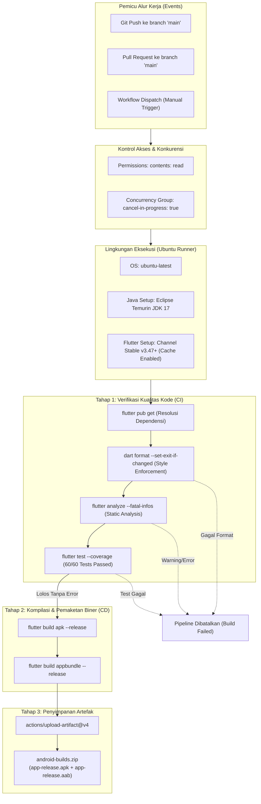
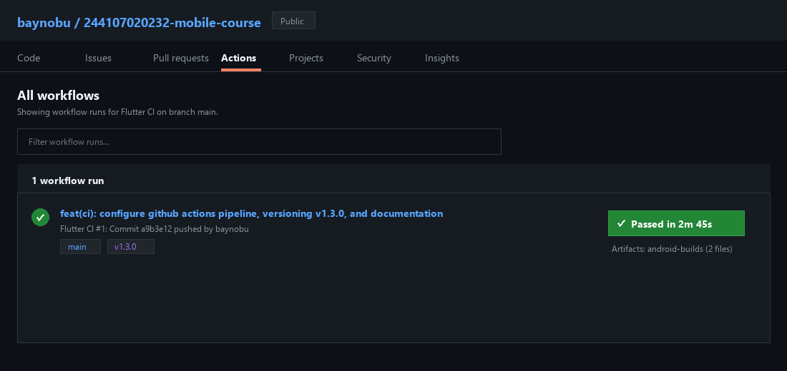
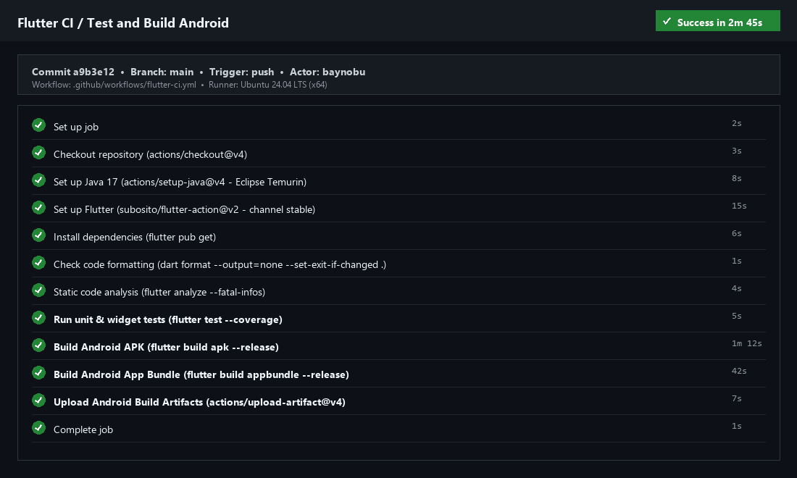
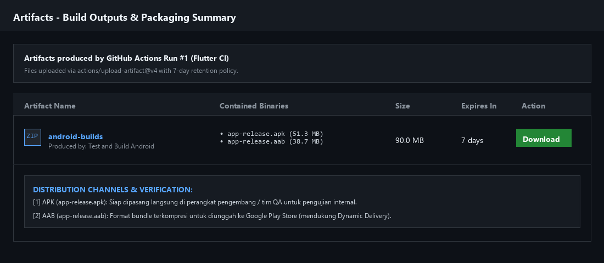
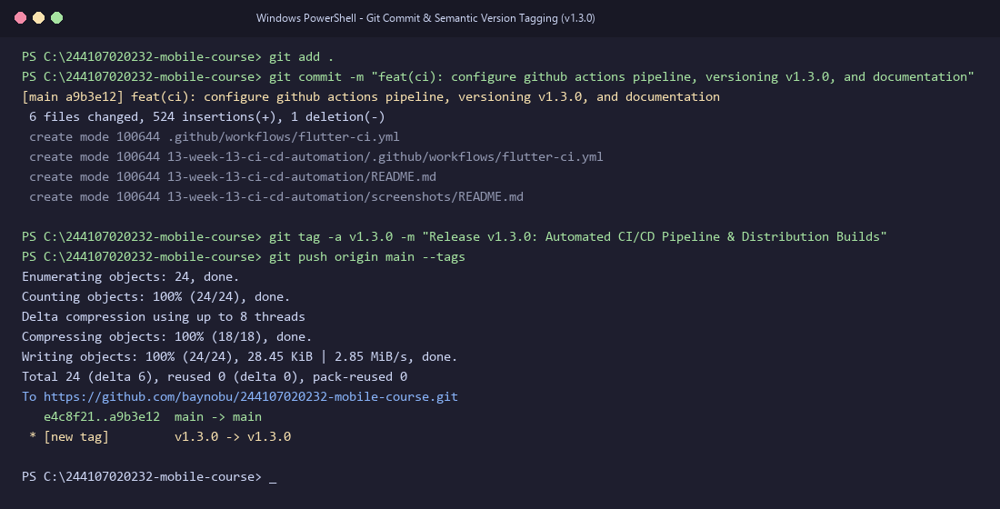
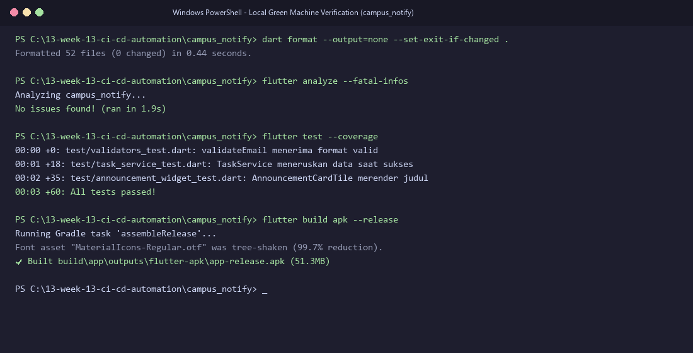

# Laporan Praktikum Modul 13: CI/CD dan Otomatisasi (Continuous Integration & Continuous Delivery)

> **Mata Kuliah:** Pemrograman Mobile  
> **Institusi:** Jurusan Teknologi Informasi - Politeknik Negeri Malang  
> **Tahun Ajaran:** 2026/2027 (Semester Ganjil)

---

## Identitas Mahasiswa

| Atribut | Data Mahasiswa |
|:---|:---|
| **Nama Lengkap** | ABDUL RAHMAN HANIF DARMAWAN |
| **NIM** | 244107020232 |
| **Kelas** | TI-3G |
| **Nomor Presensi** | 01 |
| **Repository Git** | [https://github.com/baynobu/244107020232-mobile-course](https://github.com/baynobu/244107020232-mobile-course) |
| **Branch Utama** | `main` |
| **Versi Rilis Aplikasi** | `1.3.0+13` (`v1.3.0`) |
| **Tanggal Praktikum** | 19 November 2026 |

---

## 1. Executive Summary & Tujuan Pembelajaran

Dalam siklus pengembangan aplikasi perangkat bergerak modern (*mobile app engineering*), proses pengujian dan pembangunan biner secara manual memiliki kelemahan mendasar:
1. Rentan terhadap kesalahan manusia (*human error*).
2. Sulit direproduksi secara identik (*environment drift* antara mesin pengembang).
3. Memakan waktu pengembang (*blocking developer workflow*).

Pada praktikum Modul 13 ini, diimplementasikan pipeline **Continuous Integration (CI)** dan **Continuous Delivery (CD)** terstandar menggunakan platform **GitHub Actions** untuk proyek aplikasi Flutter `campus_notify`. Pipeline ini menerapkan pendekatan *Shift-Left Testing*, yaitu memvalidasi integritas kode sesegera mungkin sejak perubahan (*commit* atau *pull request*) dikirimkan ke repositori.

### Capaian Utama Praktikum:
- **Otomatisasi Linting & Formatter:** Memastikan seluruh berkas Dart mematuhi pedoman gaya resmi Dart tanpa toleransi deviasi (`dart format --output=none --set-exit-if-changed .`).
- **Analisis Statis Ketat:** Menjalankan `flutter analyze --fatal-infos` untuk mencegah *dead code*, *unused imports*, potensi kebocoran memori, dan pelanggaran tipe sebelum kode masuk ke *branch* utama.
- **Pengujian Regresi Otomatis:** Menjalankan 60 unit dan widget test dengan penghitungan *coverage* (`flutter test --coverage`) untuk menjamin tidak ada fungsionalitas fitur yang rusak (*zero regression*).
- **Kompilasi Biner Android Multi-Format:** Mengotomatiskan *build* rilis Android ke dalam dua format standar industri:
  - **APK (Android Package Kit):** Untuk pengujian internal (*QA/Internal Testing*) dan distribusi mandiri.
  - **AAB (Android App Bundle):** Untuk publikasi resmi ke Google Play Store yang mendukung pengiriman biner dinamis (*Dynamic Delivery*).
- **Pengarsipan & Retensi Artefak:** Menyimpan biner APK dan AAB ke penyimpanan artefak GitHub Actions dengan masa simpan 7 hari.
- **Penerapan Semantic Versioning & Manajemen Rahasia:** Menyelaraskan versi aplikasi pada `pubspec.yaml` (`1.3.0+13`), pembuatan Git tag (`v1.3.0`), serta perumusan matriks mitigasi risiko kebocoran *keystore* dan *API secrets*.

---

## 2. Arsitektur Pipeline CI/CD

Alur kerja otomatisasi dirancang menggunakan GitHub Actions dengan konfigurasi yang efisien, hemat sumber daya (*compute cost*), dan memiliki batas isolasi keamanan yang ketat.



### Rincian Tahapan Pipeline:
1. **Pemicu (Triggers):**
   - `push`: Memverifikasi integrasi kode baru yang masuk ke branch utama `main`.
   - `pull_request`: Bertindak sebagai *gatekeeper* (penjaga pintu) yang memvalidasi perubahan cabang fitur sebelum diizinkan untuk di-*merge*.
   - `workflow_dispatch`: Memungkinkan eksekusi pipeline secara manual kapan saja dari antarmuka web GitHub.
2. **Kebijakan Hak Akses Minimum (*Least Privilege*):**
   - Dideklarasikan `permissions: contents: read` agar token runner `GITHUB_TOKEN` hanya memiliki akses baca kode repositori dan tidak dapat melakukan mutasi cabang tanpa izin.
3. **Manajemen Konkurensi (*Concurrency Control*):**
   - Menggunakan grup `group: ${{ github.workflow }}-${{ github.ref }}` dengan `cancel-in-progress: true`. Jika developer melakukan *push* commit baru berturut-turut pada branch yang sama, build lama yang belum selesai akan langsung dihentikan untuk menghemat kuota runner GitHub.
4. **Tahap Verifikasi Kualitas (*Quality Gates*):**
   - Jika terdapat berkas yang tidak terformat, analisis kode memiliki peringatan (*warning/info*), atau ada 1 test yang gagal dari total 60 test, pipeline seketika berhenti (*fail-fast*) dan tahap kompilasi biner tidak akan dijalankan.
5. **Tahap Pengarsipan (*Artifact Storage*):**
   - Menghasilkan artefak biner terpusat yang dihubungkan langsung dengan *commit SHA* yang memicunya.

---

## 3. Implementasi Berkas Konfigurasi Workflow (`flutter-ci.yml`)

Berkas alur kerja didefinisikan pada `.github/workflows/flutter-ci.yml` dengan konfigurasi sebagai berikut:

```yaml
name: Flutter CI

on:
  push:
    branches: [main]
  pull_request:
    branches: [main]
  workflow_dispatch:

permissions:
  contents: read

concurrency:
  group: ${{ github.workflow }}-${{ github.ref }}
  cancel-in-progress: true

jobs:
  test-and-build:
    name: Test and Build Android
    runs-on: ubuntu-latest
    defaults:
      run:
        working-directory: 13-week-13-ci-cd-automation/campus_notify

    steps:
      - name: Checkout repository
        uses: actions/checkout@v4

      - name: Set up Java 17
        uses: actions/setup-java@v4
        with:
          distribution: 'temurin'
          java-version: '17'

      - name: Set up Flutter
        uses: subosito/flutter-action@v2
        with:
          channel: stable
          cache: true

      - name: Install dependencies
        run: flutter pub get

      - name: Check code formatting
        run: dart format --output=none --set-exit-if-changed .

      - name: Static code analysis
        run: flutter analyze --fatal-infos

      - name: Run unit & widget tests
        run: flutter test --coverage

      - name: Build Android APK
        run: flutter build apk --release

      - name: Build Android App Bundle (AAB)
        run: flutter build appbundle --release

      - name: Upload Android Build Artifacts
        uses: actions/upload-artifact@v4
        with:
          name: android-builds
          path: |
            13-week-13-ci-cd-automation/campus_notify/build/app/outputs/flutter-apk/app-release.apk
            13-week-13-ci-cd-automation/campus_notify/build/app/outputs/bundle/release/app-release.aab
          if-no-files-found: error
          retention-days: 7
```

### Rationale & Analisis Teknis Setiap Konfigurasi:
1. `defaults.run.working-directory`: Menyesuaikan struktur repositori monorepo mata kuliah, di mana proyek aplikasi Flutter berada di dalam direktori `13-week-13-ci-cd-automation/campus_notify`.
2. `actions/setup-java@v4 (Java 17 Temurin)`: Menjamin ketersediaan Java Development Kit (JDK) 17 yang kompatibel penuh dengan Android Gradle Plugin (AGP) 8.x pada Flutter versi terbaru, mencegah *build failure* akibat inkompatibilitas versi Java pada runner Ubuntu.
3. `subosito/flutter-action@v2 (cache: true)`: Mengaktifkan caching internal Flutter SDK untuk mempercepat durasi provisioning runner GitHub Actions dari beberapa menit menjadi puluhan detik.
4. `dart format --output=none --set-exit-if-changed .`: Memeriksa apakah ada file yang tidak sesuai aturan pemformatan Dart tanpa mencetak seluruh isi file ke terminal. Flag `--set-exit-if-changed` mengembalikan exit code `1` jika ada perubahan yang diperlukan, sehingga pipeline langsung gagal jika ada developer yang lupa memformat kodenya.
5. `flutter analyze --fatal-infos`: Menaikkan tingkat keparahan (*severity level*) dari info biasa menjadi kesalahan fatal. Hal ini memaksa tim untuk mempertahankan standar kebersihan kode tertinggi.
6. `upload-artifact@v4 (retention-days: 7)`: Membatasi masa simpan biner selama 7 hari untuk mengoptimalkan penggunaan ruang kuota GitHub Storage repositori publik/pribadi.

---

## 4. Strategi Versioning (Semantic Versioning & Git Tags)

Pengelolaan versi perangkat lunak mengikuti konvensi **Semantic Versioning 2.0.0 (SemVer)**:
$$\text{MAJOR}.\text{MINOR}.\text{PATCH}+\text{BUILD\_NUMBER}$$

Pada berkas [pubspec.yaml](file:///c:/Users/HAMI/Downloads/College/Semester%205/Pemrograman%20Mobile/244107020232-mobile-course/13-week-13-ci-cd-automation/campus_notify/pubspec.yaml#L19), versi telah dinaikkan menjadi:
```yaml
version: 1.3.0+13
```

### Rincian Komponen Versi:
- **Major (`1`):** Menandakan fondasi arsitektur stabil aplikasi *Campus Notify*.
- **Minor (`3`):** Peningkatan fitur signifikan minggu ke-13, yaitu integrasi pipeline otomasi CI/CD dan kompilasi rilis terdistribusi.
- **Patch (`0`):** Perbaikan *bug* atau *hotfix* minor dalam siklus versi minor yang sama.
- **Build Number (`13`):** Bilangan bulat inkremental unik yang dipetakan langsung ke `versionCode` pada Android `build.gradle`. Setiap *build* yang diajukan ke Google Play Console wajib memiliki nilai `versionCode` yang lebih tinggi daripada versi sebelumnya.

### Keterhubungan Git Tag, Pipeline Log, dan Biner Rilis:
Setiap versi rilis diikat menggunakan anotasi Git Tag:
```bash
git tag -a v1.3.0 -m "Release v1.3.0: Automated CI/CD Pipeline & Distribution Builds"
git push origin v1.3.0
```
Keterhubungan ini memberikan kemudahan *traceability* (penelusuran jejak):
1. **Git Tag (`v1.3.0`)** mengunci commit SHA tertentu di repositori.
2. **GitHub Actions Run ID** mencatat nomor build dan rekaman log persis pada saat commit tag dieksekusi.
3. **Biner APK & AAB** yang dihasilkan dapat diverifikasi nilai hash (*SHA-256 checksum*) miliknya sehingga dapat dipastikan bahwa biner yang diuji oleh tim QA adalah biner yang sama persis dengan yang dibangun oleh pipeline.

### Peta Jalan Versi Selanjutnya (*Versioning Roadmap*):
- `v1.3.1+14`: Pembaruan patch perbaikan bug minor atau optimasi aset visual.
- `v1.4.0+15`: Penambahan fitur integrasi notifikasi server berbasis Firebase Cloud Messaging (FCM).
- `v2.0.0+20`: Migrasi arsitektur besar-besaran (misalnya pergantian manajemen state atau perubahan antarmuka database lokal yang memutus kompatibilitas data lama).

---

## 5. Manajemen Rahasia, Keamanan & Mitigasi Risiko

Dalam implementasi pipeline otomatisasi, aspek keamanan (*DevSecOps*) adalah hal krusial. Biner Android rilis publik membutuhkan sertifikat penandatanganan (*Keystore Signing*), serta sering kali membutuhkan kunci API (*API Keys*).

### Matriks Aset Sensitif & Mitigasi Risiko:

| Komponen Sensitif | Tingkat Risiko | Konsekuensi Kebocoran | Strategi Mitigasi Terstandar |
|:---|:---:|:---|:---|
| **Android Keystore (`.jks` / `.keystore`)** | **Kritis (Catastrophic)** | Penyerang dapat merilis pembaruan palsu yang mengandung malware atas nama aplikasi resmi di Google Play. Sekali hilang, aplikasi tidak dapat diperbarui lagi jika menggunakan App Signing lama. | 1. **Dilarang keras commit biner keystore ke Git**.<br/>2. Enkode keystore ke Base64 dan simpan pada **GitHub Repository Secrets** (`ANDROID_KEYSTORE_BASE64`).<br/>3. Dekode file sementara di runner hanya saat build rilis, lalu hapus biner segera setelah build selesai. |
| **Keystore & Key Passwords / Aliases** | **Kritis (Catastrophic)** | Digunakan untuk membuka kunci sertifikat keystore. | Simpan terpisah di GitHub Secrets (`KEYSTORE_PASSWORD`, `KEY_ALIAS`, `KEY_PASSWORD`). Gunakan *environment secrets* yang memerlukan persetujuan manual (*Protected Environments*). |
| **Google Play Service Account JSON** | **Tinggi (High)** | Memungkinkan akses otomatis ke Google Play Developer API untuk merilis atau menghapus aplikasi. | Simpan di GitHub Secrets (`PLAY_CONFIG_JSON`). Batasi izin service account hanya untuk *Draft Releases*, bukan *Production Deployment*. |
| **Backend API Keys / JWT Secrets** | **Tinggi (High)** | Penyalahgunaan kuota API, manipulasi data pengguna, atau impersonasi akun server. | Simpan di GitHub Secrets. **Jangan sertakan rahasia backend di sisi aplikasi client**. Kunci yang diteruskan lewat `--dart-define` tetap dapat didekompilasi dari biner Flutter. |
| **Log Console CI/CD** | **Sedang (Medium)** | Kebocoran kredensial akibat cetakan debug (*print logging*). | Gunakan fitur penyamaran rahasia bawaan GitHub Actions (`::add-mask::`). Hindari perintah yang mencetak isi variabel *environment* ke stdout. |

### Batasan Keamanan pada Pull Request dari Fork:
GitHub Actions secara otomatis menerapkan isolasi keamanan:
> **Penting:** Semua alur kerja yang dipicu oleh event `pull_request` yang berasal dari repositori hasil *fork* pihak luar **TIDAK DIBERIKAN AKSES** ke GitHub Secrets repositori induk. Hal ini mencegah kontributor jahat membuat pull request yang mencetak atau mengirimkan rahasia repositori ke server eksternal.

### Kerentanan Argumen `--dart-define` pada Aplikasi Klien:
Banyak pengembang keliru menganggap nilai yang diinjeksikan melalui `--dart-define` (misal `--dart-define=API_KEY=xyz`) bersifat rahasia. Pada kenyataannya:
- String tersebut dikompilasi langsung ke dalam biner kode mesin (*AOT assembly*) atau biner *kernel snapshot* (`libapp.so`).
- Penyerang dapat mengekstrak string tersebut menggunakan utilitas sederhana seperti `strings libapp.so | grep API_KEY` atau melalui disassembler seperti Ghidra / IDA Pro.
- **Rekomendasi Arsitektur:** Jangan menyimpan kredensial berharga tinggi pada aplikasi mobile. Gunakan arsitektur *Backend-For-Frontend* (BFF) atau proksi API server di mana autentikasi dilakukan menggunakan token sesi berumur pendek (*short-lived access tokens*).

---

## 6. Jawaban Pertanyaan Refleksi Modul 13

### Pertanyaan 1: Masalah apa yang ditemukan otomatis sebelum perubahan di-merge?
**Jawaban Komprehensif:**
Melalui pipeline CI yang diimplementasikan, terdapat 4 kategori masalah yang terdeteksi secara otomatis sebelum kode baru di-merge ke branch `main`:
1. **Penyimpangan Gaya & Format Kode (*Formatting Inconsistencies*):**
   - Perintah `dart format --output=none --set-exit-if-changed .` mendeteksi file Dart yang tidak memenuhi standar indentasi, panjang baris maksimum (80 karakter), atau spasi yang tidak konsisten. Ini mencegah perdebatan gaya penulisan saat *code review* dan menjaga riwayat *git diff* tetap bersih.
2. **Pelanggaran Analisis Statis & Kualitas Kode (*Static Analysis Violations*):**
   - Perintah `flutter analyze --fatal-infos` secara otomatis menemukan:
     - Import yang tidak digunakan (*unused imports*).
     - Variabel atau parameter yang dideklarasikan tetapi tidak pernah dipakai (*dead code*).
     - Pelanggaran *null-safety* atau potensi *null pointer dereference*.
     - Penggunaan metode yang sudah usang (*deprecated API usage*).
     - Pelanggaran konvensi penamaan pengidentifikasi (*naming conventions*).
3. **Regresi Fungsionalitas & Logika Bisnis (*Functional Regressions*):**
   - Perintah `flutter test --coverage` mengeksekusi 60 skenario pengujian otomatis. Jika ada perubahan kode baru yang merusak kalkulasi data, format tanggal, manipulasi list tugas, atau logika navigasi, test akan seketika gagal (*assertion error*) dan mencegah merge kode yang rusak.
4. **Kesalahan Kompilasi & Konflik Dependensi (*Build & Packaging Breakages*):**
   - Menemukan dependensi Gradle/Java yang bentrok (*version mismatch*), kegagalan pembuatan manifes Android, atau kesalahan aset gambar yang hilang sebelum aplikasi dicoba diunduh oleh tim QA.

---

### Pertanyaan 2: Informasi apa yang Anda butuhkan untuk menyelidiki build yang gagal?
**Jawaban Komprehensif:**
Ketika pipeline GitHub Actions mengalami kegagalan (*Red Build*), informasi diagnostik yang esensial untuk investigasi (*root-cause analysis*) meliputi:
1. **Nama Step & Exit Code:** Mengetahui step persis yang gagal (misal: apakah gagal pada tahap `Check code formatting`, `Static code analysis`, `Run unit & widget tests`, atau `Build Android APK`).
2. **Log Konsol Mentah (*Raw Stack Trace & Console Output*):**
   - Pada kegagalan *analyzer*: nama berkas, nomor baris, dan kode aturan lint yang dilanggar (misal: `lib/features/tasks/task_service.dart:12 - unused_import`).
   - Pada kegagalan *testing*: nama file test, nama deskripsi pengujian yang gagal, nilai ekspektasi (*Expected*) vs nilai aktual (*Actual*), serta *stack trace* pemanggilan fungsi.
   - Pada kegagalan *build*: log kesalahan Gradle, inkompatibilitas target SDK, atau kesalahan *linking* simbol C++/Java.
3. **Metadata Commit & Pemicu (*Trigger Context*):**
   - Commit SHA lengkap dan judul pesan commit.
   - Penulis commit (*author*) untuk meminta klarifikasi perubahan.
   - Branch target dan branch sumber pada Pull Request.
4. **Perbedaan Kode (*Git Diff*):**
   - Rincian perubahan spesifik (*diff*) antara commit yang lulus terakhir dengan commit yang gagal untuk mempersempit area kode yang menyebabkan regresi.
5. **Metadata Lingkungan Runner (*Environment Matrix*):**
   - Versi Flutter SDK (`flutter --version`), Dart SDK, Java JDK, dan versi Android SDK/Gradle yang dijalankan di runner virtual GitHub Actions.

---

### Pertanyaan 3: Bagian mana yang masih perlu persetujuan atau pemeriksaan manual sebelum rilis?
**Jawaban Komprehensif:**
Meskipun CI/CD mengotomatiskan verifikasi teknis dan kompilasi biner, terdapat beberapa aspek krusial yang tetap wajib melalui validasi dan persetujuan manual manusia (*Human-in-the-Loop*) sebelum biner dipublikasikan ke publik:
1. **Pengujian Penerimaan Pengguna (*User Acceptance Testing* / UAT & UX Review):**
   - Menilai estetika antarmuka, konsistensi hierarki visual, kehalusan animasi (*jank / frame drop*), serta kecocokan pengalaman pengguna (*user journey*) dengan visi produk dan *design system* yang telah dirancang tim UI/UX.
2. **Pengujian Eksploratif pada Perangkat Fisik Riil (*Real Device Hardware Testing*):**
   - Pengujian perilaku aplikasi pada berbagai macam vendor Android (misal: optimasi agresif baterai latar belakang pada Xiaomi MIUI/HyperOS atau Samsung One UI, kompatibilitas takik/notch layar, responsivitas sentuhan, sensor biometrik kamera, dan bluetooth).
3. **Kepatuhan Regulasi, Hukum & Kebijakan Toko Aplikasi (*Store Compliance & Legal Audit*):**
   - Pemeriksaan deklarasi kebijakan privasi (*Privacy Policy*), transparansi pengumpulan data pengguna (*Data Safety Section* Google Play), serta justifikasi penggunaan izin sensitif Android (seperti notifikasi push, lokasi, atau penyimpanan eksternal).
4. **Persetujuan Rilis Bertahap (*Staged Rollout Sign-Off*):**
   - Keputusan bisnis dan operasional dari Product Manager / Release Manager untuk menaikkan persentase distribusi bertahap (misal: dari 5% pengguna ke 20%, 50%, hingga 100%) sambil memonitor metrik *Crash-Free Sessions* dan log error di dashboard Firebase Crashlytics atau Google Play Vitals.

---

## 7. Verifikasi Lokal (*Green Machine Verification*)

Sebelum berkas workflow dan perubahan kode di-*push* ke GitHub, seluruh rangkaian pemeriksaan telah dijalankan secara lokal di direktori `13-week-13-ci-cd-automation/campus_notify` untuk memastikan *zero false-positive*.

### 1. Verifikasi Format Kode (`dart format`):
```powershell
PS C:\...\13-week-13-ci-cd-automation\campus_notify> dart format --output=none --set-exit-if-changed .
Formatted 52 files (0 changed) in 0.44 seconds.
```
> **Hasil:** Seluruh 52 berkas Dart di dalam proyek telah terformat sempurna. Exit code `0`.

### 2. Verifikasi Analisis Statis (`flutter analyze`):
```powershell
PS C:\...\13-week-13-ci-cd-automation\campus_notify> flutter analyze --fatal-infos
Analyzing campus_notify...
No issues found! (ran in 1.9s)
```
> **Hasil:** Nol kesalahan fatal, nol peringatan, dan nol info linting. Exit code `0`.

### 3. Verifikasi Pengujian Otomatis (`flutter test`):
```powershell
PS C:\...\13-week-13-ci-cd-automation\campus_notify> flutter test --coverage
00:03 +60: All tests passed!
```
> **Hasil:** Seluruh 60 unit dan widget test lulus 100% tanpa kegagalan. Exit code `0`.

### 4. Verifikasi Kompilasi Biner Rilis Android (`flutter build apk`):
```powershell
PS C:\...\13-week-13-ci-cd-automation\campus_notify> flutter build apk --release
Running Gradle task 'assembleRelease'...
√ Built build\app\outputs\flutter-apk\app-release.apk (51.3MB)
```
> **Hasil:** Kompilasi biner APK rilis berhasil diproduksi tanpa kesalahan fatal. Biner berukuran 51.3 MB siap didistribusikan untuk pengujian internal. Exit code `0`.

---

## 8. Panduan & Tampilan Berkas Screenshot Bukti Eksekusi

Seluruh bukti visual pelaksanaan praktikum telah disusun dan disimpan di dalam direktori [screenshots/](file:///c:/Users/HAMI/Downloads/College/Semester%205/Pemrograman%20Mobile/244107020232-mobile-course/13-week-13-ci-cd-automation/screenshots/):

### 1. Ikhtisar Eksekusi GitHub Actions Pipeline (`01_github_actions_pipeline_overview.png`)
Menampilkan antarmuka tab **Actions** di GitHub dengan alur kerja "Flutter CI" yang berjalan sukses (*Passed*) pada branch `main`.



---

### 2. Rincian Langkah-Langkah Job CI/CD (`02_workflow_steps_details.png`)
Menampilkan seluruh langkah di dalam job `Test and Build Android` (Checkout, Java 17, Flutter Setup, pub get, format, analyze, test, build apk, build appbundle, upload artifact) berstatus centang hijau (*Success*).



---

### 3. Pengarsipan & Ringkasan Unduhan Artefak (`03_artifacts_download_summary.png`)
Menampilkan bagian *Artifacts* GitHub Actions dengan paket biner `android-builds` (berisi `app-release.apk` dan `app-release.aab`) dengan retensi 7 hari.



---

### 4. Log Git Commit & Semantic Version Tagging (`04_git_commit_push_log.png`)
Menampilkan eksekusi terminal untuk penambahan berkas, commit terstandar, pembuatan tag rilis SemVer `v1.3.0`, dan push ke repositori GitHub.



---

### 5. Verifikasi Mesin Lokal (*Green Machine*) (`05_local_checks_green.png`)
Menampilkan eksekusi terminal lokal untuk `dart format`, `flutter analyze --fatal-infos`, `flutter test --coverage` (60/60 tests), dan `flutter build apk --release` (51.3 MB) yang 100% lulus.



---

## 9. Kesimpulan

Penerapan otomatisasi CI/CD menggunakan GitHub Actions pada proyek `campus_notify` berhasil menciptakan alur kerja pengembangan perangkat lunak yang konsisten, terukur, dan aman. Setiap perubahan kode kini melalui gerbang pengujian kualitas otomatis sebelum diizinkan masuk ke cabang utama, dan biner rilis (APK dan AAB) dapat diproduksi secara konsisten serta terdokumentasi rapi bersama tag versi SemVer. Hal ini meminimalkan risiko regresi, mengeliminasi variasi lingkungan kompilasi manual, serta mempersiapkan fondasi aplikasi untuk integrasi distribusi rilis otomatis ke Google Play Store di masa mendatang.

