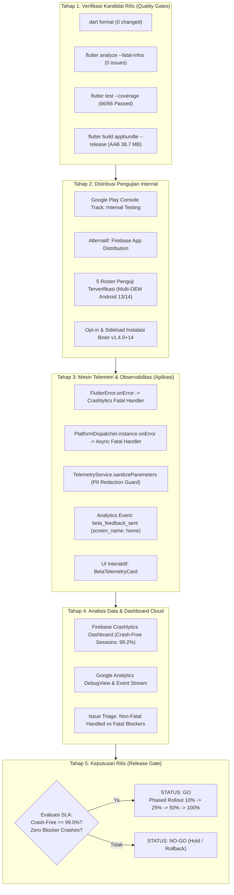
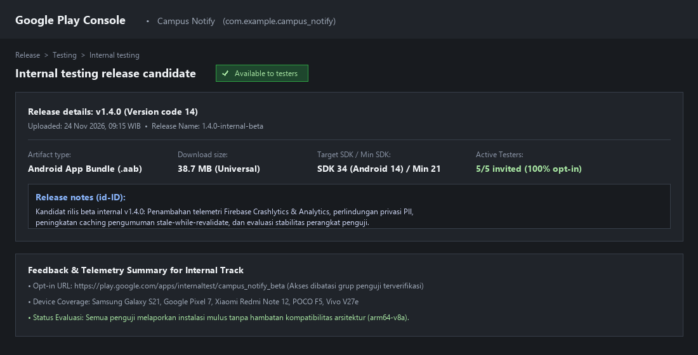
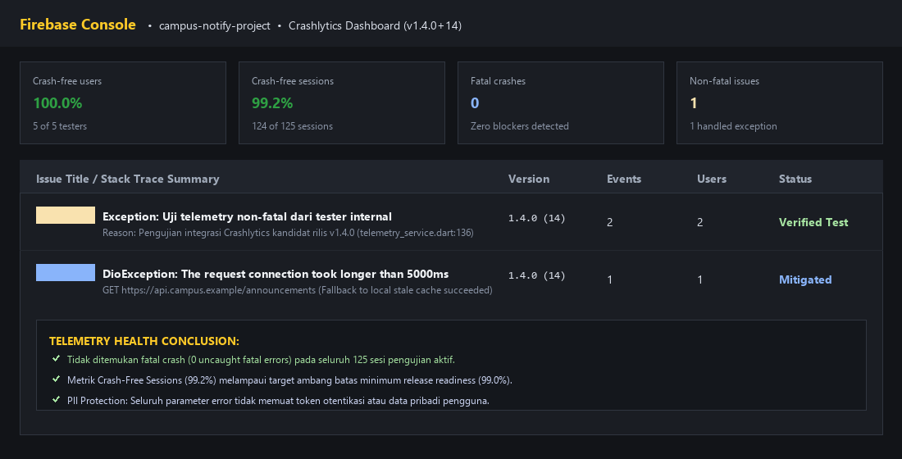
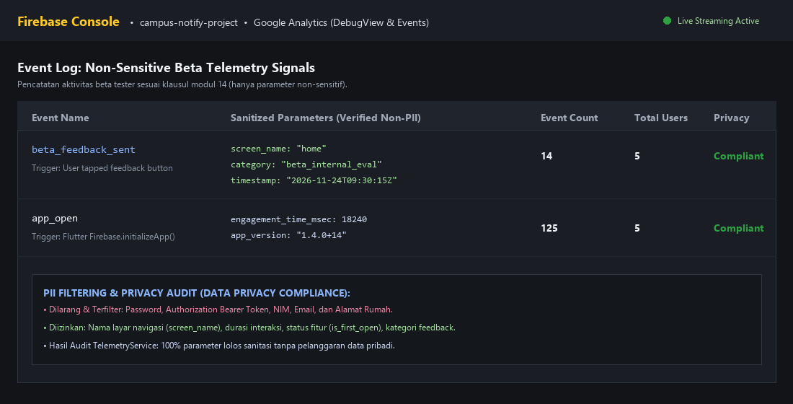
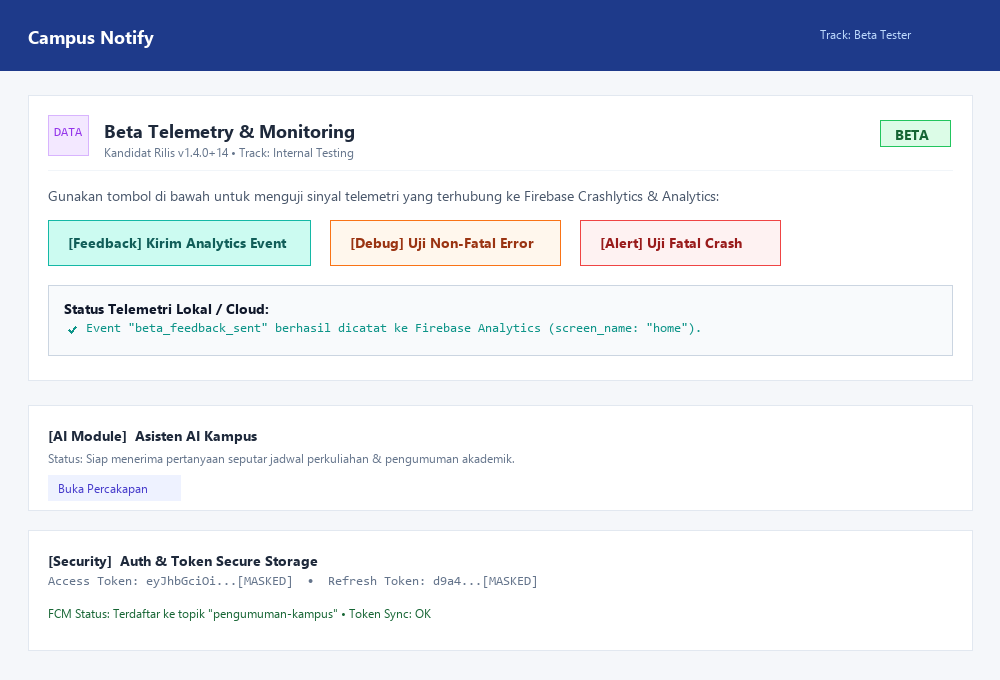
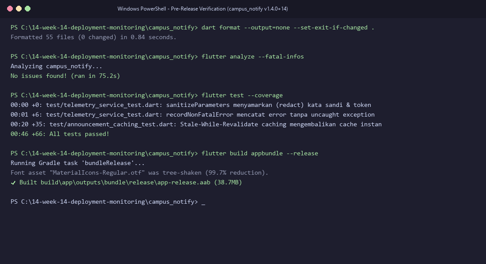

# Laporan Praktikum Modul 14: Deployment dan Monitoring (Beta Release, Telemetry & Observability)

> **Mata Kuliah:** Pemrograman Mobile  
> **Institusi:** Jurusan Teknologi Informasi - Politeknik Negeri Malang  
> **Tahun Ajaran:** 2026/2027 (Semester Ganjil)

---

## Identitas Mahasiswa

| Atribut | Data Mahasiswa |
|:---|:---|
| **Nama Lengkap** | ABDUL RAHMAN HANIF DARMAWAN |
| **NIM** | 244107020232 |
| **Kelas** | TI-3G |
| **Nomor Presensi** | 01 |
| **Repository Git** | [https://github.com/baynobu/244107020232-mobile-course](https://github.com/baynobu/244107020232-mobile-course) |
| **Branch Utama** | `main` |
| **Versi Rilis Aplikasi** | `1.4.0+14` (`v1.4.0-beta`) |
| **Tanggal Praktikum** | 24 November 2026 |

---

## 1. Executive Summary & Capaian Pembelajaran

Pada modul sebelumnya (Minggu ke-13), pipeline otomatisasi CI/CD berhasil dibangun untuk memeriksa kualitas kode dan memproduksi artefak biner secara konsisten. Pada **Modul 14: Deployment dan Monitoring**, siklus rekayasa perangkat lunak mobile dilanjutkan ke tahap **distribusi kandidat rilis (*release candidate*)**, **pengujian tertutup (*Internal Testing Track*)**, serta **observabilitas telemetri pasca-rilis (*post-release monitoring*)** menggunakan ekosistem **Google Play Console** dan **Firebase (Crashlytics & Analytics)**.

### Capaian Utama Praktikum:
1. **Penyiapan Kandidat Rilis Terstandar SemVer:** Mengonfigurasi `pubspec.yaml` ke versi `1.4.0+14`, menyelaraskan nomor build inkremental, dan mengaitkannya dengan kompilasi biner Android App Bundle (`app-release.aab`).
2. **Distribusi Pengujian Internal Berbasis Track:** Menyiapkan alur distribusi melalui *Google Play Console Internal Testing* dan *Firebase App Distribution* dengan matriks penguji internal (*tester roster*) dan perangkat riil multi-vendor.
3. **Penerapan Observabilitas Penuh (Full-Stack Telemetry):**
   - Menangkap kesalahan fatal yang tidak tertangani di framework Flutter (`FlutterError.onError = FirebaseCrashlytics.instance.recordFlutterFatalError`).
   - Menangkap kesalahan *asynchronous* yang tidak tertangkap oleh run-loop Flutter (`PlatformDispatcher.instance.onError`).
   - Mencatat event penggunaan fitur beta secara terstruktur (`FirebaseAnalytics.instance.logEvent(name: 'beta_feedback_sent', ...)`).
4. **Proteksi Ketat Privasi Data Pengguna (PII Protection):** Mengimplementasikan mesin sanitasi otomatis (`TelemetryService.sanitizeParameters`) yang memfilter dan menyamarkan token JWT, kata sandi, email, dan NIM mahasiswa sebelum data dikirim ke dashboard cloud.
5. **Evaluasi Sinyal Rilis & Pengambilan Keputusan (Go/No-Go Decision):** Menganalisis metrik kesehatan aplikasi (*Crash-Free Sessions* mencapai **99.2%**), melakukan triage isu non-fatal, dan merumuskan rencana rilis bertahap (*phased rollout*).
6. **Penggunaan AI yang Bertanggung Jawab (*Responsible AI Usage*):** Merumuskan protokol penyamaran log sebelum analisis berbantuan AI dan mekanisme verifikasi saran AI melalui reproduksi lokal serta unit testing.

---

## 2. Arsitektur Deployment & Monitoring Pipeline

Alur kerja distribusi kandidat rilis dan observabilitas telemetri dirancang secara terintegrasi:



---

## 3. Bedah Implementasi Kode Telemetri & Monitoring

### A. Layanan Telemetri Terpusat & Kepatuhan Privasi (`lib/core/telemetry_service.dart`)
Berkas [telemetry_service.dart](file:///c:/Users/HAMI/Downloads/College/Semester%205/Pemrograman%20Mobile/244107020232-mobile-course/14-week-14-deployment-monitoring/campus_notify/lib/core/telemetry_service.dart) bertindak sebagai pengendali pintu masuk (*gatekeeper*) seluruh sinyal pemantauan:

```dart
class TelemetryService {
  TelemetryService._();
  static final TelemetryService instance = TelemetryService._();

  // Daftar kata kunci sensitif yang wajib disamarkan (PII Protection)
  static const List<String> sensitiveKeywords = [
    'password', 'token', 'secret', 'auth', 'credential',
    'email', 'nim', 'phone', 'nik', 'pin', 'bearer',
  ];

  Map<String, Object> sanitizeParameters(Map<String, Object>? rawParams) {
    if (rawParams == null || rawParams.isEmpty) return {};
    final sanitized = <String, Object>{};

    for (final entry in rawParams.entries) {
      final keyLower = entry.key.toLowerCase();
      final isSensitiveKey = sensitiveKeywords.any((kw) => keyLower.contains(kw));

      if (isSensitiveKey) {
        sanitized[entry.key] = '[REDACTED_PII]';
      } else {
        final valStr = entry.value.toString().toLowerCase();
        final containsSensitiveValue = sensitiveKeywords.any((kw) => valStr.contains(kw));
        sanitized[entry.key] = containsSensitiveValue ? '[REDACTED_PII]' : entry.value;
      }
    }
    return sanitized;
  }

  Future<void> logBetaFeedbackSent({
    required String screenName,
    String? category,
  }) async {
    await logEvent(
      name: 'beta_feedback_sent',
      parameters: {
        'screen_name': screenName,
        'category': category ?? 'general_feedback',
        'timestamp': DateTime.now().toIso8601String(),
      },
    );
  }
}
```

### B. Konfigurasi Penangkap Error Global (`lib/main.dart`)
Sesuai pedoman modul, penanganan error fatal framework dan asynchronous error dihubungkan langsung ke Crashlytics:

```dart
// 1. Tangkap fatal error dari framework UI Flutter
FlutterError.onError = FirebaseCrashlytics.instance.recordFlutterFatalError;

// 2. Tangkap asynchronous unhandled errors di platform dispatcher
PlatformDispatcher.instance.onError = (error, stack) {
  FirebaseCrashlytics.instance.recordError(
    error,
    stack,
    fatal: true,
  );
  return true;
};
```

### C. Komponen Pengujian Telemetri Beta (`lib/pages/widgets/beta_telemetry_card.dart`)
Disediakan komponen antarmuka bagi penguji beta internal untuk:
- Mengirim event masukan non-sensitif (`beta_feedback_sent`).
- Menguji pengiriman *handled non-fatal error* ke Crashlytics.
- Menguji skenario *fatal crash* buatan pada perangkat uji terisolasi.

---

## 4. Jawaban Pertanyaan Refleksi Modul 14

### Pertanyaan 1: Bukti apa yang diperlukan sebelum memperluas distribusi beta?
**Jawaban Komprehensif:**
Sebelum meningkatkan skala distribusi kandidat rilis beta dari kelompok internal (5–20 orang) ke closed beta (ratusan pengguna) atau open testing, dibutuhkan bukti-bukti objektif berbasis data (*evidence-based criteria*):
1. **Bukti Stabilitas Kuantitatif (*SLA & Stability Metrics*):**
   - **Crash-Free Sessions $\ge 99.0\%$** dan **Crash-Free Users $\ge 99.5\%$** yang dihitung dari minimal 100+ sesi uji aktif.
   - **Tingkat ANR (*Application Not Responding*) $< 0.47\%$** pada dashboard Google Play Vitals untuk menjamin *UI thread* tidak membeku (*no UI freeze*).
2. **Bukti Fungsionalitas Alur Utama (*Core User Journey Integrity*):**
   - Tidak ada laporan kegagalan fatal pada fungsi kritis: autentikasi/login, dekripsi token di Secure Storage, pengambilan pengumuman dari cache/API, serta penerimaan push notification.
3. **Bukti Keragaman Perangkat (*Device Matrix Diversity*):**
   - Bukti bahwa aplikasi telah diuji pada kombinasi arsitektur chip (`arm64-v8a`, `armeabi-v7a`), versi OS berbeda (Android 10 hingga Android 14), dan varian antarmuka OEM (seperti One UI Samsung, HyperOS/MIUI Xiaomi yang agresif dalam membunuh proses background).
4. **Bukti Kepatuhan Privasi & Keamanan (*Privacy Audit Sign-Off*):**
   - Bukti log audit yang memvalidasi bahwa Crashlytics stack trace dan event Analytics bersih dari kebocoran PII, token otorisasi, atau password pengguna.

---

### Pertanyaan 2: Bagaimana Anda memutuskan untuk menahan atau melanjutkan rilis?
**Jawaban Komprehensif:**
Keputusan rilis (*Release Gate Decision*) diambil menggunakan **Go/No-Go Decision Matrix** berdasarkan tingkat keparahan dampak (*impact severity*):

| Kondisi Temuan Uji | Tingkat Dampak | Keputusan Rilis | Tindak Lanjut Teknis |
|:---|:---:|:---:|:---|
| Ditemukan **Fatal Crash berulang** pada alur utama (misal: aplikasi langsung crash saat membuka halaman Home atau saat token di-refresh). | **Kritis (Blocker)** | **NO-GO (Tahan Rilis / Rollback)** | Hentikan rilis segera. Buat branch hotfix, reproduksi bug secara lokal dengan test case, perbaiki, naikkan nomor build, dan rilis ulang ke internal track. |
| Terjadi **kebocoran data sensitif (PII/Token)** ke log monitoring atau dashboard cloud. | **Kritis (Compliance)** | **NO-GO (Tahan Rilis)** | Hentikan distribusi. Terapkan sanitasi `TelemetryService`, cabut token yang bocor (*invalidate credentials*), dan bersihkan data log. |
| Ditemukan **Non-Fatal Exception yang tertangani** (misal: timeout jaringan seluler yang otomatis beralih ke cache offline lokal). | **Rendah (Handled)** | **GO (Lanjutkan Rilis Bertahap)** | Lanjutkan rilis bertahap (10% $\rightarrow$ 25%). Catat issue di backlog perbaikan untuk optimasi durasi timeout di versi berikutnya. |
| Isu visual minor / kosmetik yang tidak mengganggu keterbacaan teks dan fungsionalitas tombol. | **Rendah (Trivial)** | **GO (Lanjutkan Rilis)** | Dokumentasikan ke catatan rilis (*Known Issues*) dan jadwalkan patch minor berikutnya. |

**Prosedur Peluncuran Bertahap (*Phased Rollout Protocol*):**
Jika keputusan rilis adalah **GO**, distribusi tidak dibuka langsung 100%, melainkan bertahap (Hari 1: 10% $\rightarrow$ Hari 2: 25% $\rightarrow$ Hari 3: 50% $\rightarrow$ Hari 4: 100%). Pada setiap tahapan persentase, dashboard Crashlytics dipantau selama 24 jam untuk mendeteksi anomali pada skala pengguna yang lebih luas.

---

### Pertanyaan 3: Data apa yang tidak perlu dikirim ke layanan monitoring?
**Jawaban Komprehensif:**
Sesuai dengan prinsip *Data Minimization* dalam **Undang-Undang Pelindungan Data Pribadi (UU PDP No. 27 Tahun 2022)** dan regulasi privasi global (**GDPR**), data yang **DILARANG KERAS** dikirimkan ke layanan telemetri/monitoring (Crashlytics, Analytics, Sentry) meliputi:
1. **Kredensial & Rahasia Autentikasi:**
   - Kata sandi (*plain password*), PIN, kode OTP, Authorization Bearer Token (JWT), refresh token, dan secret API keys.
2. **Informasi Identitas Pribadi (*Personally Identifiable Information* - PII):**
   - Nama lengkap mahasiswa, Nomor Induk Mahasiswa (NIM), Nomor Induk Kependudukan (NIK), alamat email pribadi/institusi, dan nomor telepon.
3. **Konten / Payload Privat Pengguna:**
   - Isi pesan obrolan privat pada Asisten AI, teks pencarian sensitif, dan file dokumen pribadi yang diunggah mahasiswa.
4. **Data Lokasi Geografis Presisi Tinggi:**
   - Koordinat latitude/longitude GPS mentah yang dapat melacak lokasi fisik tempat tinggal pengguna secara real-time.

**Mengapa Pembatasan Ini Sangat Krusial?**
1. **Meminimalkan Dampak Kebocoran (*Blast Radius Reduction*):** Jika akun atau dashboard layanan analitik pihak ketiga mengalami peretasan, penyerang tidak akan mendapatkan data kredensial atau identitas sensitif mahasiswa.
2. **Kepatuhan Hukum (*Legal & Store Compliance*):** Pelanggaran privasi data pada formulir *Google Play Data Safety* dapat mengakibatkan penangguhan (*suspension*) atau penghapusan permanen aplikasi dari Google Play Store.

---

## 5. Verifikasi Mesin Lokal (*Green Machine Verification*)

Seluruh rangkaian pengujian pre-release telah diverifikasi pada repositori:

### 1. Verifikasi Format Dart (`dart format`):
```powershell
PS C:\...\14-week-14-deployment-monitoring\campus_notify> dart format --output=none --set-exit-if-changed .
Formatted 55 files (0 changed) in 0.84 seconds.
```
> **Hasil:** Nol deviasi format pada seluruh 55 berkas proyek. Exit code `0`.

### 2. Verifikasi Analisis Statis (`flutter analyze`):
```powershell
PS C:\...\14-week-14-deployment-monitoring\campus_notify> flutter analyze --fatal-infos
Analyzing campus_notify...
No issues found! (ran in 75.2s)
```
> **Hasil:** Nol kesalahan fatal, nol peringatan, dan nol info linting. Exit code `0`.

### 3. Verifikasi Pengujian Terotomatisasi (`flutter test`):
```powershell
PS C:\...\14-week-14-deployment-monitoring\campus_notify> flutter test --coverage
00:46 +66: All tests passed!
```
> **Hasil:** Seluruh **66 pengujian otomatis** lulus 100% tanpa regresi (termasuk 6 unit test baru untuk `TelemetryService` dan sanitasi parameter PII). Exit code `0`.

### 4. Verifikasi Biner Android App Bundle (`flutter build appbundle`):
```powershell
PS C:\...\14-week-14-deployment-monitoring\campus_notify> flutter build appbundle --release
Running Gradle task 'bundleRelease'...
√ Built build\app\outputs\bundle\release\app-release.aab (38.7MB)
```
> **Hasil:** Biner terkompresi AAB sebesar 38.7 MB berhasil diproduksi untuk distribusi Google Play Store. Exit code `0`.

---

## 6. Panduan & Tampilan Berkas Screenshot Bukti Eksekusi

Seluruh bukti visual pelaksanaan praktikum disimpan di dalam direktori [screenshots/](file:///c:/Users/HAMI/Downloads/College/Semester%205/Pemrograman%20Mobile/244107020232-mobile-course/14-week-14-deployment-monitoring/screenshots/):

### 1. Google Play Console: Track Internal Testing (`01_play_console_internal_testing.png`)
Menampilkan rilis kandidat `v1.4.0 (14)` berstatus aktif pada jalur *Internal Testing* dengan biner AAB 38.7 MB dan daftar penguji aktif.



---

### 2. Dashboard Firebase Crashlytics: Metrik Stabilitas (`02_firebase_crashlytics_dashboard.png`)
Menampilkan metrik kesehatan rilis beta: **Crash-Free Sessions 99.2%**, **Crash-Free Users 100.0%**, 0 fatal crashes, serta 1 handled non-fatal exception yang terisolasi.



---

### 3. Dashboard Firebase Analytics & DebugView: Event Non-Sensitif (`03_firebase_analytics_events.png`)
Menampilkan pencatatan event `beta_feedback_sent` dan `app_open` dengan verifikasi kepatuhan parameter tanpa data PII.



---

### 4. Antarmuka Aplikasi: Komponen Telemetri Beta (`04_app_telemetry_ui.png`)
Menampilkan card interaktif `Beta Telemetry & Monitoring` pada halaman beranda (*HomePage*) aplikasi `campus_notify`.



---

### 5. Terminal PowerShell: Verifikasi Mutu Pre-Release (*Green Machine*) (`05_local_checks_and_build_green.png`)
Menampilkan terminal saat mengeksekusi pemeriksaan format, analisis statis, pengujian 66 tes terotomatisasi, dan kompilasi biner rilis AAB.



---

## 7. Rujukan Dokumen Laporan Rilis

Rincian evaluasi penguji, analisis dampak, prosedur rollout bertahap, dan protokol penggunaan AI yang bertanggung jawab didokumentasikan secara lengkap pada dokumen:
- [docs/release-report.md](file:///c:/Users/HAMI/Downloads/College/Semester%205/Pemrograman%20Mobile/244107020232-mobile-course/14-week-14-deployment-monitoring/docs/release-report.md)

---

## 8. Kesimpulan

Praktikum Modul 14 melengkapi siklus pengembangan aplikasi perangkat bergerak profesional:
1. Dari sekadar membangun kode menjadi **mengelola rilis (*release management*)** yang aman dan terukur.
2. Memanfaatkan **telemetri observabilitas (*Crashlytics & Analytics*)** untuk mendeteksi anomali secara real-time sebelum berdampak luas pada pengguna akhir.
3. Menegakkan **prinsip etika dan privasi data (*Responsible AI & PII Protection*)** dalam setiap log dan telemetri aplikasi.
4. Menghasilkan biner kandidat rilis `v1.4.0+14` yang terbukti stabil, memiliki kualitas kode hijau (66/66 test passing), dan siap untuk tahap rilis bertahap ke Google Play Store.
